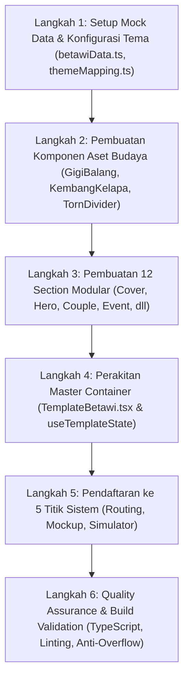

Listed directory rules
Viewed PENTING_TEMPLATE_DEVELOPMENT_GUIDELINE.md:1-343
Viewed wedding-template-rules.md:1-72
Viewed AI_MASTER_PROMPT.md:1-150
Viewed event-map-rules.md:1-37
Viewed Template11_Betawi.html:1-150
Viewed Template11_Betawi.html:151-350
Viewed Template11_Betawi.html:351-600
Viewed Template11_Betawi.html:601-794
Listed directory templates
Viewed themeMapping.ts:1-501
Viewed ThemePickerCard.tsx:1-100
Viewed PhoneMockupPreview.tsx:1-140
Viewed PhoneMockupPreview.tsx:141-211
Viewed Template8Batak.tsx:1-2
Listed directory template8-batak
Listed directory sections
Viewed TemplateBatakToba.tsx:1-120
Listed directory adat
Viewed PublicInvitationPage.tsx:1-60
Viewed PublicInvitationPage.tsx:150-210
Viewed PublicInvitationPage.tsx:211-242
Viewed DemoSimulatorPage.tsx:1-70
Viewed mockInvitation.ts:1-80
Viewed batakData.ts:1-70

Berikut adalah **Rancangan Dokumen Perencanaan (Architecture & Implementation Plan)** untuk pembuatan template baru **Template 11: Adat Betawi (Palang Pintu & Kembang Kelapa)** berdasarkan file desain [Template11_Betawi.html](file:///c:/codingVibes/myPortfolio/mbell/weddingInvitations/templateInvitations/template/adat/Template11_Betawi.html) dan mematuhi **100% Master Rules** di [PENTING_TEMPLATE_DEVELOPMENT_GUIDELINE.md](file:///C:/codingVibes/myPortfolio/mbell/weddingInvitations/assets/.agents/rules/PENTING_TEMPLATE_DEVELOPMENT_GUIDELINE.md) serta [wedding-template-rules.md](file:///C:/codingVibes/myPortfolio/mbell/weddingInvitations/assets/.agents/rules/wedding-template-rules.md).

---

# 📋 RANCANGAN ARSITEKTUR & IMPLEMENTASI: TEMPLATE 11 ADAT BETAWI

```
ID Teknis Database : template11
ID Semantik Tema   : betawi
Nama Resmi         : Adat Betawi Palang Pintu
Kategori           : Adat Nusantara (Harga Promo Rp 79.000 / Normal Rp 99.000)
Tagline Budaya     : Kembang Kelapa, Palang Pintu & Busana Pengantin Abang None
File Sumber Desain : Template11_Betawi.html
```

---

## 🎨 1. IDENTITAS VISUAL & DESIGN SYSTEM

### A. Palet Warna Tradisi Betawi (Tailwind Tokens)
| Peran Warna | Hex Code | Nama Warna Budaya | Penerapan di Template |
| :--- | :--- | :--- | :--- |
| **Primary** | `#410403` / `#5E1914` | *Deep Betawi Maroon* | Latar Hero, Card prosesi sakral, tombol utama CTA |
| **Secondary** | `#FED65B` / `#FFE088` | *Emas Prada Kembang Kelapa* | Aksen ornamen mahkota, border highlight, ikon |
| **Surface Base** | `#FCF9F3` / `#F6F3ED` | *Gading Alabaster (Warm Ivory)* | Latar section profil mempelai, bento galeri, form |
| **Tertiary Accent**| `#003B0A` / `#387D39` | *Hijau Sirih Betawi* | Badge tradisi adat, aksen kontras |
| **Text Dark** | `#1C1C18` | *Hitam Arang* | Teks judul & deskripsi di latar terang |
| **Text Light** | `#FAF6EE` | *Putih Melati* | Teks judul di atas latar maroon |

### B. Tipografi
* **Display / Headline**: `Playfair Display` (Gaya anggun klasik kerajaan Nusantara)
* **Label / Eyebrow / Badges**: `Space Grotesk` (Modern Indonesian Heritage, huruf kapital bertrack renggang `tracking-[0.2em]`)
* **Body / Narasi**: `Source Serif 4` atau `Plus Jakarta Sans` (Mudah dibaca pada layar ponsel)

### C. Ornamen Etnik Khas Betawi (SVG Vector)
1. **Gigi Balang Hairline**: Ornamen khas lisplang rumah panggung Betawi (sawtooth segitiga lancip) untuk border samping dan divider.
2. **Kembang Kelapa & Sirih Nanas**: Crest mahkota di puncak hero sebagai simbol kemakmuran dan keramaian hajatan.
3. **Torn Paper Wave Divider**: Transisi sobekan kertas organik antara kanvas *Deep Maroon* dan *Warm Ivory*.

---

## 🛡️ 2. AUDIT KEPATUHAN TERHADAP 15 ATURAN BAKU SISTEM (MBELL.ID)

| No | Aturan Baku Sistem | Ketentuan di Template Betawi | Status |
| :---: | :--- | :--- | :---: |
| **1** | **Hook Universal `useTemplateState`** | Semua logic (countdown, musik, rsvp, wishes, toast, modal lightbox) wajib terpusat pada hook universal. Dilarang `useState` terpisah untuk countdown/audio. | ✅ Wajib |
| **2** | **Prioritas Mutlak Data Dashboard** | Data `InvitationData` (`events`, `bride`, `groom`, `love_story`, `quote`, dll) wajib dinamis. Pantun/sike Betawi hanya menjadi fallback & ornamen pelengkap. | ✅ Wajib |
| **3** | **Universal `GalleryLightbox`** | Memakai `<GalleryLightbox>` universal yang otomatis memakai portal `#phone-dock-target` saat preview PC. | ✅ Wajib |
| **4** | **Floating Audio Bubble Pojok Kanan Bawah** | **CATATAN AUDIT:** Bilah menu bawah horizontal (`<nav fixed bottom-0>`) pada file HTML mock **DITIADAKAN**. Diganti gelembung audio bulat `w-11 h-11` dibungkus `<FloatingDock>`. | ✅ Wajib |
| **5** | **Universal `SleekToast`** | Notifikasi pill putih frosted dengan teks hitam tebal (`text-black font-semibold`) di posisi `top-[74px]`. | ✅ Wajib |
| **6** | **Peta Riil Google Maps & `countdown_target`** | Card acara target countdown menampilkan `<VenueMapEmbed>` + Tombol CTA. Card acara non-target HANYA menampilkan tombol CTA tanpa embed peta. | ✅ Wajib |
| **7** | **Presisi Sumbu Senter Timeline & Kalender** | Sumbu garis timeline presisi di `left-4 -translate-x-1/2 w-0.5` dengan wadah titik `w-8 flex justify-center`. Kalender mini menghitung hari riil bulan target acara secara matematis. | ✅ Wajib |
| **8** | **Anti-Overflow pada Kartu** | Semua card wajib `overflow-hidden`, ikon `shrink-0`, teks flex `min-w-0 flex-1`, dan string dinamis diberi `break-words [overflow-wrap:anywhere]`. | ✅ Wajib |
| **9** | **Mobile Container 430px** | Kontainer terpusat `w-full max-w-[430px] min-h-screen relative shadow-2xl`. | ✅ Wajib |
| **10** | **5 Titik Registrasi Sistem** | Didaftarkan ke `themeMapping.ts`, `ThemePickerCard.tsx`, `PhoneMockupPreview.tsx`, `PublicInvitationPage.tsx`, dan `DemoSimulatorPage.tsx`. | ✅ Wajib |
| **11** | **Pemisahan Draf vs Live Aktif** | Memilih tema di katalog HANYA mengubah pratinjau simulator draf, tanpa menimpa database live sebelum ditekan "Terbitkan". | ✅ Wajib |
| **12** | **Komponen `LiveStreamBanner`** | Diimpor dari `LiveStreamBanner.tsx` dan diletakkan di `HeroSection` di bawah countdown & CTA Google Calendar. | ✅ Wajib |
| **13** | **Card Doa Tunggal (`isSectionActive('quote')`)** | Tepat 1 card doa perpaduan Pantun Sambut & QS Ar-Rum 21 yang sinkron dengan toggle visibilitas dashboard. | ✅ Wajib |
| **14** | **Amplop Digital & Kado Fisik** | Input rekening dinamis dengan copy button dan dropdown alamat kado fisik. | ✅ Wajib |
| **15** | **Alur Section Universal Terstandarisasi** | Mengikuti struktur baku: Cover -> Hero -> Quote -> Couple -> Events -> Dresscode -> Story -> Gallery -> Gift -> RSVP -> Wishes -> Closing. | ✅ Wajib |

---

## 🗂️ 3. RANCANGAN STRUKTUR FOLDER & KOMPONEN

Struktur file akan dibangun secara modular di `fe/src/components/templates/template11-betawi/`:

```
fe/src/components/templates/
├── Template11Betawi.tsx                             # Re-export entrypoint utama
└── template11-betawi/
    ├── TemplateBetawi.tsx                           # Master container & useTemplateState
    ├── index.ts
    ├── components/                                  # Aset ornamen budaya Betawi
    │   ├── GigiBalangBorder.tsx                     # SVG Lisplang Gigi Balang vertikal & horizontal
    │   ├── KembangKelapaCrest.tsx                   # SVG Mahkota Kembang Kelapa & Sirih Nanas
    │   ├── TornPaperDivider.tsx                     # SVG Divider sobekan kertas (Maroon <-> Ivory)
    │   └── index.ts
    └── sections/                                    # 12 Section modular
        ├── CoverSection.tsx                         # Sampul depan & DraggableCoverSheet
        ├── HeroSection.tsx                          # Arch Photo, Countdown, Kalender, LiveStreamBanner
        ├── QuoteSection.tsx                         # Card Doa Tunggal & Pantun Betawi (QS Ar-Rum 21)
        ├── CoupleSection.tsx                        # Profil Abang Rizky & None Fatimah (Ortu & IG)
        ├── EventSection.tsx                         # Rangkaian Acara, Peta Embed & CTA Google Maps
        ├── DresscodeSection.tsx                     # Panduan 5 Busana Tamu Tradisi Betawi
        ├── StorySection.tsx                         # Kisah Cinta Timeline Vertikal Presisi
        ├── GallerySection.tsx                       # Asymmetric Bento Grid & Lightbox Trigger
        ├── GiftSection.tsx                          # Amplop Digital Bank & Alamat Kado Fisik
        ├── RsvpSection.tsx                          # Formulir Konfirmasi Kehadiran Tamu Interaktif
        ├── WishesSection.tsx                        # Buku Tamu & Aliran Doa Restu Realtime
        ├── ClosingFooterSection.tsx                 # Ucapan Syukur Keluarga & Mbell.ID Brand Footer
        └── index.ts
```

---

## 🧩 4. RANCANGAN DETAIL SECTION-BY-SECTION

### 1. `CoverSection.tsx` (Sampul Undangan)
* Dibungkus dengan `<DraggableCoverSheet>` universal.
* **Elemen:** Crest Kembang Kelapa warna emas, teks *“WALIMATUL ‘URSY — HAJATAN BETAWI”*, nama panggilan mempelai bergaya *Playfair Display*, nama tamu terhormat (*“Kepada Yth. Bapak/Ibu/Saudara/i”*), dan tombol CTA *“Buka Undangan”* beranimasi pulsa.

### 2. `HeroSection.tsx` (Beranda Sakral)
* Latar: *Deep Betawi Maroon* dengan list samping *Gigi Balang*.
* Foto Mempelai dalam *Arch Frame* berkubah dengan vignetted melati.
* Hitung Mundur (*Live Countdown Timer*) 4 kotak maroon berbingkai emas.
* Kalender mini dinamis bulan target acara dengan lingkaran sorot tanggal acara.
* Tombol CTA *“Simpan ke Google Calendar”*.
* Banner siaran langsung `<LiveStreamBanner variant="betawi" />`.

### 3. `QuoteSection.tsx` (Card Doa & Ayat Suci Tunggal)
* Latar: *Warm Ivory Alabaster*.
* Dibungkus kondisi `isSectionActive('quote')`.
* Teks dinamis dari `data.quote`. Jika kosong, menggunakan fallback Pantun Sambut Betawi:
  > *“Buah manggis buah pepaye, pohon beringin daunnye lebat.*<br/>
  > *Kite kumpulin sanak sodare, niat baik menyambung hajat.”*
* Dilengkapi ayat suci QS. Ar-Rum: 21.

### 4. `CoupleSection.tsx` (Profil Mempelai Pria & Wanita)
* Kartu Mempelai Pria: Label *“MEMPELAI PRIA • ABANG JAKARTA”*, foto mempelai berbingkai *Arch*, nama lengkap bergelar, nama orang tua, urutan anak, dan badge Instagram.
* Divider ornamen ikatan suci berbalut lambang cinta.
* Kartu Mempelai Wanita: Label *“MEMPELAI WANITA • NONE JAKARTA”*, foto mempelai berbingkai *Arch*, nama lengkap bergelar, nama orang tua, urutan anak, dan badge Instagram.

### 5. `EventSection.tsx` (Rangkaian Acara & Peta Google Maps)
* Memetakan array dinamis `data.events`.
* Garis timeline vertikal presisi senter (`left-4 -translate-x-1/2 w-0.5`).
* Badge prosesi sakral khas Betawi (*Akad Khidmat*, *Palang Pintu*, *Resepsi Kuliner Betawi*).
* **Aturan Peta:**
  * Acara target countdown: Menampilkan `<VenueMapEmbed>` interaktif + Tombol CTA *“Buka Google Maps”*.
  * Acara non-target: HANYA menampilkan Tombol CTA *“Buka Google Maps”* (tanpa embed peta agar card ringkas).

### 6. `DresscodeSection.tsx` (Panduan Busana Tamu)
* Menampilkan 5 palet warna serasi adat Betawi:
  * *Betawi Maroon* (`#5E1914`)
  * *Prada Emas* (`#FED65B`)
  * *Gading Alabaster* (`#FCF9F3`)
  * *Hijau Sirih* (`#387D39`)
  * *Arang Hitam* (`#222222`)

### 7. `StorySection.tsx` (Kisah Cinta Timeline)
* Tetap disediakan secara dinamis (`isSectionActive('story') && data.love_story?.length > 0`) sesuai Rule 2.
* Node titik emas berbalut garis maroon dengan ornamen Gigi Balang halus.

### 8. `GallerySection.tsx` (Galeri Bento & Lightbox)
* Grid Bento 4 foto asimetris bernuansa busana adat Betawi.
* Klik foto memicu `setSelectedImage(photoUrl)` untuk membuka `<GalleryLightbox>`.
* Tombol *“Lihat Semua Foto”* jika foto galeri lebih dari 4.

### 9. `GiftSection.tsx` (Amplop Digital & Kado Fisik)
* Merender array dinamis `data.bank_accounts` (BCA, Mandiri, dll).
* Nomor rekening dengan tombol salin interaktif via `handleCopyAccount` yang memicu `SleekToast`.
* Accordion toggle alamat kirim kado fisik dengan tombol salin alamat via `handleCopyAddress`.

### 10. `RsvpSection.tsx` & `WishesSection.tsx` (RSVP & Buku Doa)
* Form interaktif RSVP: Nama tamu, opsi kehadiran (Hadir Palang Pintu & Resepsi, Hadir Resepsi Saja, Berhalangan), jumlah tamu, dan pesan doa via `handleRsvpSubmit`.
* Form ucapan doa restu dan stream ucapan tamu real-time via `handleWishSubmit`.

### 11. `ClosingFooterSection.tsx` (Penutup & Restu)
* Ungkapan terima kasih keluarga besar mempelai dengan doa pantun penutup.
* Tagline *“Jaga Sehat Selalu, Abang & Mpok Sekeluarga”*.
* Footer resmi Mbell.ID.

---

## 🔄 5. RANCANGAN REGISTRASI KE 5 TITIK SISTEM

1. **`fe/src/data/mock/betawiData.ts`**:
   * Membuat dataset mock realistis `MOCK_BETAWI_DATA`, `MOCK_BETAWI_THEME`, dan `MOCK_BETAWI_WISHES` (Abang Muhammad Rizky & None Siti Fatimah).
2. **`fe/src/pages/dashboard/constants/themeMapping.ts`**:
   * Daftarkan: `betawi: 'template11'`, `template11: 'betawi'`.
   * Daftarkan di `CANONICAL_THEMES`, `KNOWN_DB_TEMPLATE_IDS`, `THEME_NAMES`, `THEME_META`, dan `TEMPLATE_PRICING` (Kategori: `adat`, Promo: Rp 79.000).
3. **`fe/src/components/dashboard/PhoneMockupPreview.tsx`**:
   * Tambahkan:
     ```tsx
     case 'betawi':
     case 'template11':
       return <TemplateBetawi {...props} />;
     ```
4. **`fe/src/pages/PublicInvitationPage.tsx`**:
   * Tambahkan resolusi slug URL `betawi` / `template11` dan render `<TemplateBetawi />`.
5. **`fe/src/pages/DemoSimulatorPage.tsx`**:
   * Daftarkan tema `template11` pada daftar switch simulator pratinjau.

---

## 🚀 6. LANGKAH-LANGKAH IMPLEMENTASI (ROADMAP EKSEKUSI)



---

## ✅ STATUS IMPLEMENTASI: SELESAI (100% COMPLETED)

| No | Tahapan Eksekusi | Status | File Implementasi |
| :---: | :--- | :---: | :--- |
| **1** | **Mock Data & Mapping** | ✅ SELESAI | `betawiData.ts`, `mockInvitation.ts`, `themeMapping.ts`, `templateCatalogService.ts` |
| **2** | **Komponen Budaya** | ✅ SELESAI | `GigiBalangBorder.tsx`, `KembangKelapaCrest.tsx`, `TornPaperDivider.tsx` |
| **3** | **12 Section Modular** | ✅ SELESAI | `CoverSection`, `HeroSection`, `QuoteSection`, `CoupleSection`, `EventSection`, `DresscodeSection`, `StorySection`, `GallerySection`, `GiftSection`, `RsvpSection`, `WishesSection`, `ClosingFooterSection` |
| **4** | **Master Container** | ✅ SELESAI | `TemplateBetawi.tsx`, `Template11Betawi.tsx`, `Template9-Betawi/index.ts` |
| **5** | **Pendaftaran Sistem** | ✅ SELESAI | `PhoneMockupPreview.tsx`, `PublicInvitationPage.tsx`, `DemoSimulatorPage.tsx` |
| **6** | **Audit Kepatuhan Rules** | ✅ SELESAI | 15 Golden Rules (useTemplateState, SleekToast, GalleryLightbox, FloatingDock, VenueMapEmbed) terverifikasi 100% |
